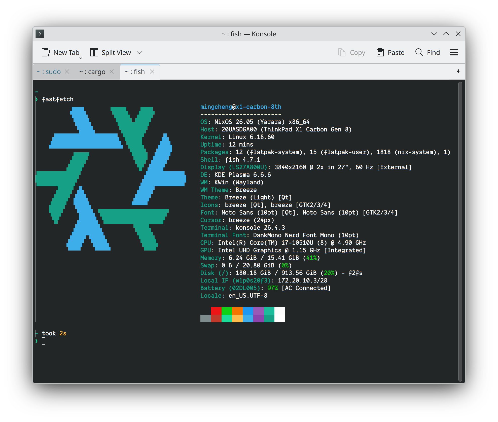

# 明城的 NixOS 配置



适用于 ThinkPad X1 Carbon Gen 8、QEMU 客户机与 USB 启动盘的个人配置。基于 **NixOS 26.05 / x86_64-linux**，使用传统 channel 管理，不依赖 flakes。

## 选择主机

| `NIX_BUILD_HOST`                                     | 适用场景                                                               |
| ---------------------------------------------------- | ---------------------------------------------------------------------- |
| [`x1-carbon-8th`](hosts/x1-carbon-8th/default.nix)   | ThinkPad X1 Carbon Gen 8：Plasma Wayland、PipeWire、Fcitx5/Rime 输入法 |
| [`vm-image`](hosts/vm-image/default.nix)             | QEMU 客户机基础配置，非可直接启动的磁盘镜像                            |
| [`usb-boot-stick`](hosts/usb-boot-stick/default.nix) | USB 启动盘：通用硬件支持、可移动 UEFI 引导、命令行维护工具             |

构建时必须通过 `NIX_BUILD_HOST` 指定其中一项；系统主机名默认与之相同，可用 `networking.hostName` 覆盖。

## 快速开始

以下以已安装 NixOS、仓库位于 `/etc/nixos` 的 X1 为例；使用其他主机时替换命令中的 `x1-carbon-8th`。

### 1. 接入本机配置

先备份 `configuration.nix` 与 `hardware-configuration.nix`，再在 `configuration.nix` 的 `imports` 中加入 [main.nix](main.nix)：

```nix
imports = [
  ./hardware-configuration.nix
  ./main.nix
];
```

保留原有账户与登录凭据，不要用此片段替换整个文件。这两份本机文件已被 Git 忽略，请勿复制其他机器的磁盘 UUID 或硬件配置。`system.stateVersion` 是首次安装时的兼容基线，更新 channel 时不要同步修改。

### 2. 配置软件通道

通道地址定义于 [sources.nix](sources.nix)。系统与大部分软件使用 `nixos`，桌面环境的 VS Code 另需 `unstable`；仅使用 VM 或 USB 配置时无需 `unstable`：

```bash
sudo nix-channel --add https://mirrors.tuna.tsinghua.edu.cn/nix-channels/nixos-26.05 nixos
sudo nix-channel --add https://mirrors.tuna.tsinghua.edu.cn/nix-channels/nixos-unstable unstable
sudo nix-channel --update
```

也可使用脚本登记并更新指定通道，地址同样取自 `sources.nix`：

```bash
sudo bash /etc/nixos/scripts/nixconfig.sh
sudo bash /etc/nixos/scripts/nixconfig.sh unstable
```

不带参数处理 `nixos`，传入 `unstable` 则处理该通道；[channel.sh](scripts/channel.sh) 参数相同，但只登记不更新。上述命令操作 root 的通道，与普通用户通道相互独立。

### 3. 构建并应用

```bash
sudo env NIX_BUILD_HOST=x1-carbon-8th nixos-rebuild build
sudo env NIX_BUILD_HOST=x1-carbon-8th nixos-rebuild switch
```

`build` 仅生成配置、不切换系统；`switch` 会立即应用并可能重启服务。内核等变更需重启生效，首次切换后请检查网络、桌面、输入法与睡眠恢复。

## 全新安装

1. 分区。**初始化会清空目标磁盘，请核对设备路径并确认提示。** 按需选择其一：

```bash
sudo bash scripts/disk-init.sh /dev/nvme0n1
sudo bash scripts/disk-init.sh --hibernate /dev/nvme0n1
```

默认创建 GPT、1 GiB FAT32 EFI 与 F2FS 根分区；`--hibernate` 额外预留不少于内存 1.2 倍的休眠 swap。

2. 挂载分区并生成硬件配置；未创建 swap 时跳过 `swapon`：

```bash
sudo bash scripts/mount.sh
sudo swapon /dev/disk/by-label/swap
sudo nixos-generate-config --root /mnt
```

[mount.sh](scripts/mount.sh) 按 X1 的 `/boot` 布局挂载，USB 配置需改为将 EFI 挂载到 `/mnt/efi`。脚本详情见 [scripts/README.md](scripts/README.md)。

3. 将仓库放入 `/mnt/etc/nixos`，保留生成的本机配置，按上文添加 `imports`、配置通道并设置账户与登录凭据，然后安装：

```bash
sudo env NIX_BUILD_HOST=x1-carbon-8th nixos-install --root /mnt
```

挂载布局须与硬件配置一致：X1 使用 `/boot`，USB 使用 `/efi`；VM 需另行配置引导器。安装细节请参阅 [NixOS 手册](https://nixos.org/manual/nixos/stable/#sec-installation)。

## 更新与回退

| 操作         | 命令                                                                    |
| ------------ | ----------------------------------------------------------------------- |
| 更新软件     | `sudo nix-channel --update` 后重新执行 `nixos-rebuild switch`           |
| 回退一代     | `sudo env NIX_BUILD_HOST=x1-carbon-8th nixos-rebuild switch --rollback` |
| 无法正常启动 | 在启动菜单中选择保留的上一代配置                                        |

系统回退不能撤销数据库迁移等应用数据变更，重要数据请单独备份。

## 个性化配置

| 调整内容                     | 位置                                                               |
| ---------------------------- | ------------------------------------------------------------------ |
| 账户、SSH 公钥、代理、主机名 | 本机 `configuration.nix`                                           |
| 磁盘、swap、EFI 挂载点       | 本机 `hardware-configuration.nix`                                  |
| 主机硬件策略与软件组合       | [hosts/](hosts/)                                                   |
| 分层共用策略                 | [profiles/](profiles/)（`base`、`desktop`、`workstation`）         |
| 系统设置、可选服务、程序配置 | [system/](system/)、[services/](services/)、[packages/](packages/) |
| 通道地址、二进制缓存、在线 hosts | [sources.nix](sources.nix)                                     |

模块通过 `imports` 按需启用，文件存在不代表服务已开启；可选服务带有个人环境的默认值，启用前请核对账户、监听地址、端口与数据目录。修改通道地址后需重新执行 `nix-channel --add`。

- **SSH**：导入 [services/sshd.nix](services/sshd.nix)，仅允许公钥认证并禁止 root 登录，请先为账户配置公钥。
- **代理**：X1 默认使用 `http://127.0.0.1:7890`。不使用本地代理时，在本机配置中覆盖：

```nix
networking.proxy = {
  default = null;
  noProxy = "";
};
```

### 自定义 hosts

桌面配置通过 [system/network_hosts.nix](system/network_hosts.nix) 读取 [sources.nix](sources.nix) 的 `hosts` URL 列表，统一用 `builtins.fetchurl` 加入 `networking.hostFiles` 即可。

本机条目仍使用原生选项，也可追加本地文件：

```nix
networking.hosts."192.0.2.10" = [ "build.example.test" ];
networking.extraHosts = ''
  192.0.2.11 nas.example.test
'';
# networking.hostFiles = [ ./my_hosts ];
```

关闭任一来源时，从 [sources.nix](sources.nix) 的 `hosts` 列表中删除对应 URL 即可；设为 `[]` 会关闭全部远端注入，包括 StevenBlack，但不会删除本机条目。

## 测试与维护

测试按模块、主机、入口与脚本分层，只做配置求值，不会构建或切换系统：

```bash
make check
make check-modules
make check-hosts
make check-scripts
make fmt
```

依次为全部检查、仅模块、仅主机与入口、仅脚本，以及格式化 Nix 文件。需要 Nix、GNU Make、Bash 与可访问的 `<nixpkgs>`，完整测试及 GUI 主机另需 `<unstable>`；工具版本见 [mise.toml](mise.toml)。测试使用当前用户的通道，与 root 通道独立。

本机配置需单独检查：

```bash
NIX_BUILD_HOST=x1-carbon-8th make check-local
NIX_BUILD_HOST=x1-carbon-8th make check-local LOCAL_CONFIG=/etc/nixos/configuration.nix
```

[VS Code 任务](.vscode/tasks.json) 提供常用检查与本地构建入口。这些是求值与脚本回归测试，不能替代实际构建、启动及硬件验证。

## 使用提醒

- **休眠**：X1 的硬件配置须声明且仅声明一个 `/dev/` 下、未启用随机加密的 swap 分区；zram 不能替代，固件需选择 Linux/S3 睡眠模式。
- **权限**：`wheel` 组可免密码 sudo；共享配置的 Nix `trusted-users` 为 `root` 与 `@wheel`，X1 收紧为 `root` 与 `mingcheng`，仅应授予可信账户。
- **秘密信息**：不要把密码、令牌写入 Nix 表达式，它们可能进入其他用户可读的 Nix store。

## 参考

- [NixOS 手册](https://nixos.org/manual/nixos/stable/)
- [NixOS 选项查询](https://search.nixos.org/options)
- [NixOS Wiki](https://wiki.nixos.org/)
