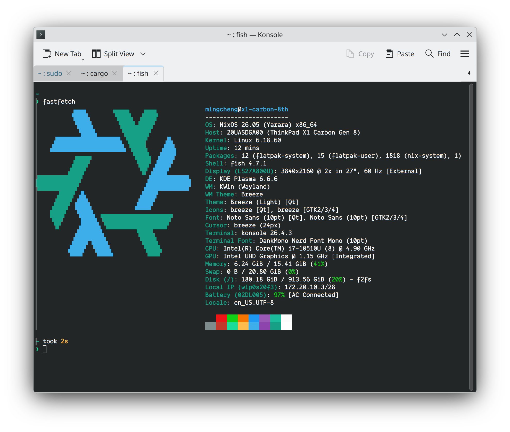

# ThinkPad X1 Carbon Gen 8 (`x1-carbon-8th`)



面向 **ThinkPad X1 Carbon Gen 8** 的主力移动开发与日常办公配置（`NIX_BUILD_HOST=x1-carbon-8th`）。基于 [profiles/laptop.nix](../../profiles/laptop.nix) 与 [profiles/develop.nix](../../profiles/develop.nix)，运行 KDE Plasma 6（Wayland）、PipeWire 与 Fcitx5/Rime，并针对 Comet Lake-U 平台、F2FS 文件系统及 S3 深度睡眠/休眠做了专门调优。

通用仓库结构、通道说明与自定义选项请参阅根目录 [README.md](../../README.md)。

## 硬件规格与驱动支持

| 组件       | 硬件型号 / 规格                             | 配置与驱动策略                                                                                              |
| ---------- | ------------------------------------------- | ----------------------------------------------------------------------------------------------------------- |
| 处理器     | Intel Core i7-10510U（Comet Lake-U，4C/8T） | 15 W TDP（CPUID `06-8e-0c`），强制启用 `hardware.cpu.intel.updateMicrocode` 修补微码安全漏洞                |
| 内存       | 16 GiB LPDDR3                               | 启用 25% `zstd` `zramSwap`（约 4 GiB 逻辑压缩交换）+ NVMe 物理休眠分区双层交换                              |
| 存储       | WD Black SN750 NVMe SSD                     | 1 GiB FAT32 EFI（挂载于 `/boot`）+ F2FS 根分区 + 独立 Linux swap 分区（`>= 1.2x` 内存，约 16.9 GiB+）       |
| 显卡与显示 | Intel UHD Graphics GT2（内建 eDP 面板）     | initrd 预加载 `i915`，安装 `intel-media-driver`（VA-API 硬解），设置 `i915.enable_psr=0` 消除内屏闪烁       |
| 无线与蓝牙 | Intel Wi-Fi 6 AX201 CNVi                    | 启用 `enableRedistributableFirmware` 与 `hardware.bluetooth.enable`，由 NetworkManager 管理无线连接         |
| 音频       | Intel cAVS（Smart Sound Technology）        | 加载 `sof-firmware`（Sound Open Firmware），配合 PipeWire / WirePlumber 提供低延迟音频                      |
| 雷电接口   | Intel JHL6540 Thunderbolt 3                 | initrd 预加载 `thunderbolt`，启用 `intel_iommu=on` DMA 隔离与 `services.hardware.bolt` 用户态授权           |
| 指纹识别   | Synaptics 掌托按压式指纹传感器              | 导入 [services/fprintd.nix](../../services/fprintd.nix)，支持 KDE 锁屏唤醒与终端认证，SDDM 首次登录保持密码 |
| 固件管理   | Lenovo UEFI / Intel ME / 设备固件           | 启用 `services.fwupd.enable`，支持通过 LVFS 在线更新 BIOS 与控制器固件                                      |

## 模块组成

| 文件                                                                 | 职责说明                                                                                        |
| -------------------------------------------------------------------- | ----------------------------------------------------------------------------------------------- |
| [default.nix](default.nix)                                           | 主机入口：组合 `laptop` + `develop`、`boot.nix`、`fprintd.nix`，声明 `mingcheng` 账户与可信权限 |
| [kernel.nix](kernel.nix)                                             | 锁定 `linuxPackages_6_12` LTS 内核，配置 initrd 模块、内核参数、微码、图形驱动、`fwupd`、`bolt` |
| [tuning.nix](tuning.nix)                                             | 配置电源策略（禁用冲突的 `thermald`）、`zramSwap`、内存与 F2FS 脏页写回 sysctl、Nix 构建并发度  |
| [tests/hosts/x1-carbon-8th.nix](../../tests/hosts/x1-carbon-8th.nix) | 主机配置纯求值回归测试（内核版本、Wayland 桌面、swap/zram、电源、防火墙与代理继承等）           |

## BIOS / UEFI 设置与启动备忘

安装或重装系统前，请先核对 ThinkPad BIOS（开机出现 ThinkPad / Lenovo 徽标时按 `Enter` 中断引导，再按 `F1` 进入 Setup，或按 `F12` 打开启动设备菜单）：

1. **睡眠状态（必选）**：进入 **Config → Power → Sleep State**，将其从默认的 `Windows 10`（S0ix 现代待机）切换为 **`Linux`**（启用 ACPI **S3** 深度睡眠）。本配置通过 `mem_sleep_default=deep` 默认使用 S3 挂起；若保留为 `Windows 10`，内核将无法暴露 `deep` 模式并导致待机耗电异常。
2. **安全启动（Secure Boot）**：使用默认 `systemd-boot` 引导时，进入 **Security → Secure Boot** 将其设为 **Disabled**（若与开启了 BitLocker 的 Windows 共存，修改前请先备份恢复密钥或挂起保护）。
3. **虚拟化与雷电 DMA 保护**：进入 **Security → Virtualization**，确认 **Intel (R) Virtualization Technology** 与 **Intel (R) VT-d Feature** 均为 **Enabled**，配合内核参数 `intel_iommu=on` 为 Thunderbolt 3 外设提供 IOMMU DMA 隔离，并供 KVM/Libvirt 虚拟化使用。
4. **USB 引导安装**：插入启动盘后开机按 `F12`，在 Boot Menu 中选择对应的 USB 设备即可引导进入安装环境。

## 安装、构建与维护

### 1. 全新安装

本机导入了 [profiles/laptop.nix](../../profiles/laptop.nix) → [system/swap.nix](../../system/swap.nix)，要求 `hardware-configuration.nix` **必须声明且仅声明一个位于 `/dev/` 下、未启用随机加密的 swap 分区**，因此初始化磁盘时必须传入 `--hibernate`：

```bash
# 1. 分区并格式化（清空磁盘：创建 1 GiB EFI、>= 1.2x 内存的 swap 分区与 F2FS 根分区）
sudo bash scripts/disk-init.sh --hibernate /dev/nvme0n1

# 2. 挂载 /mnt、/mnt/boot 并自动激活 swap，生成硬件配置
sudo bash scripts/mount.sh
sudo nixos-generate-config --root /mnt
```

将仓库放入 `/mnt/etc/nixos`，在 `/mnt/etc/nixos/configuration.nix` 的 `imports` 中加入 `./main.nix`，然后配置 root 通道并执行安装：

```bash
# 3. 写入二进制缓存并登记、更新 nixos 与 unstable 通道
sudo bash /mnt/etc/nixos/scripts/nixconfig.sh

# 4. 执行系统安装
sudo env NIX_BUILD_HOST=x1-carbon-8th nixos-install --root /mnt
```

### 2. 日常构建、更新与回退

`sudo` 默认会剥离环境变量，所有 `nixos-rebuild` 命令均需通过 `sudo env NIX_BUILD_HOST=x1-carbon-8th` 显式传入主机标识：

```bash
# 仅构建验证（不切换当前系统）
sudo env NIX_BUILD_HOST=x1-carbon-8th nixos-rebuild build

# 构建并立即切换系统配置
sudo env NIX_BUILD_HOST=x1-carbon-8th nixos-rebuild switch

# 更新软件通道后重新构建并切换
sudo nix-channel --update
sudo env NIX_BUILD_HOST=x1-carbon-8th nixos-rebuild switch

# 回退到上一代配置
sudo env NIX_BUILD_HOST=x1-carbon-8th nixos-rebuild switch --rollback
```

### 3. 配置检查与测试

```bash
# 仅运行 x1-carbon-8th 主机求值测试
make check-host-x1-carbon-8th

# 运行主机选择边界 + x1-carbon-8th 完整检查
make check-x1-carbon-8th

# 验证本机忽略的 configuration.nix / hardware-configuration.nix
NIX_BUILD_HOST=x1-carbon-8th make check-local
NIX_BUILD_HOST=x1-carbon-8th make check-local LOCAL_CONFIG=/etc/nixos/configuration.nix
```

## 内核、电源与性能调优说明

### 内核与图形（[kernel.nix](kernel.nix)）

- **内核分支**：固定为 `pkgs.linuxPackages_6_12`（6.12 LTS），兼顾 Comet Lake-U 硬件成熟度与稳定通道安全修复。
- **睡眠模式（`mem_sleep_default=deep`）**：配合 BIOS `Linux` 睡眠设置使用 S3 挂起。进入系统后可通过以下命令确认当前生效模式（应显示 `[deep]`）：
  ```bash
  cat /sys/power/mem_sleep
  ```
- **面板自刷新（`i915.enable_psr=0`）**：禁用 Intel eDP 面板自刷新（PSR），避免 UHD GT2 在 Wayland 桌面下出现偶发屏幕闪烁或局部刷新卡顿。
- **调度抢占（`preempt=full`）**：启用完全内核抢占，降低 KDE KWin Wayland 合成器与 PipeWire 音频链路在负载下的响应延迟。
- **IPv6 默认策略**：`net.ipv6.conf.all.disable_ipv6 = 1` 默认关闭 IPv6；若当前网络环境需要 IPv6，可在本机 `configuration.nix` 中用 `lib.mkForce 0` 覆盖。

### 电源管理与温控（[tuning.nix](tuning.nix)、[system/power.nix](../../system/power.nix)）

- **`power-profiles-daemon`（PPD）**：统一接管 `intel_pstate` HWP 与 ThinkPad ACPI `platform_profile`，可直接在 KDE Plasma 电源管理面板或通过 `powerprofilesctl set <power-saver|balanced|performance>` 切换档位。
- **禁用 `thermald`**：本机内核 `thinkpad_acpi` 已暴露 `dytc_lapmode`（联想动态温控接口），`thermald` 检测到后会主动退出。配置中显式设置 `services.thermald.enable = lib.mkForce false`，同时**不要额外启用 `tlp` 或 `tuned`**，以免与 PPD 及固件策略冲突。
- **合盖与自动休眠**：合盖默认进入挂起（外接扩展坞/显示器时忽略合盖），启用 `suspend-then-hibernate`，挂起满 `2h`（`HibernateDelaySec = "2h"`）后自动唤醒并写入 NVMe swap 转入 S4 深度休眠。

### 交换分区与存储写回（[tuning.nix](tuning.nix)、[system/swap.nix](../../system/swap.nix)）

- **双层 Swap 架构**：
  1. **`zramSwap`（优先级 `100`）**：使用 `zstd` 算法按需分配最高 25% 内存（约 4 GiB），优先承接日常匿名页交换。
  2. **NVMe 物理 Swap（默认低优先级）**：自动绑定至 `boot.resumeDevice`，仅在 zram 耗尽或执行系统休眠（Hibernation）时写入磁盘。
- **VM 与 F2FS 调优**：
  - `vm.swappiness = 100`、`vm.page-cluster = 0`：引导内核优先将冷匿名页单页压缩进高速 zram，而非过早回收 F2FS 文件缓存，同时关闭对压缩内存无意义的 8 页预读。
  - `vm.dirty_ratio = 10`、`vm.dirty_background_ratio = 5`：收敛 16 GiB 内存下的脏页积压上限，使 WD SN750 NVMe 保持平滑后台回写，避免单次积压约 3 GiB 脏页引发突发 I/O 阻塞。
- **Nix 构建并发控制**：默认设置 `nix.settings.max-jobs = 2`、`cores = 4`，限制 15 W 4C/8T 处理器在本地编译时的温度与内存压力；如需临时放宽，可在本机 `configuration.nix` 中覆盖。

## 外设与常用功能备忘

- **指纹识别（`fprintd`）**：
  - [services/fprintd.nix](../../services/fprintd.nix) 配置了定制 PAM 规则：**SDDM 冷启动/注销后首次登录强制使用密码**（以正常解锁 KDE Wallet 密钥环），**Plasma 锁屏唤醒（`kde-fingerprint`）与终端 `login` 开启指纹认证**。
  - 常用命令：
    ```bash
    fprintd-enroll                 # 录入当前用户指纹（需本地活跃会话管理员授权）
    fprintd-verify                 # 测试验证已录入的指纹
    fprintd-list mingcheng         # 查看已登记的指纹列表
    fprintd-delete mingcheng       # 清除已登记的指纹
    ```
- **Thunderbolt 3 外设授权（`bolt`）**：
  - 连接雷电 3 扩展坞或高速外设时，可通过 KDE 桌面弹窗授权，或在终端执行：
    ```bash
    boltctl list                   # 查看已连接的雷电设备与状态
    boltctl enroll <UUID>          # 授权并记住指定雷电设备
    ```
- **固件更新（`fwupd`）**：
  - Lenovo 通过 LVFS 提供 X1 Carbon Gen 8 的系统 BIOS、Intel ME、Thunderbolt 控制器及 NVMe 固态硬盘固件更新：
    ```bash
    fwupdmgr refresh
    fwupdmgr get-updates
    fwupdmgr update
    ```
- **内置键盘映射（`keyd`）**：
  - [services/keyd.nix](../../services/keyd.nix) 针对内置 AT 键盘（`0001:0001`）将 `Caps Lock` 复用为 **`Esc`（轻按） / `caps_control` 导航层（长按）**：按住 `Caps Lock` 时，`b`/`f`/`p`/`n`/`e` 分别对应左/右/上/下/`End` 方向键，其余组合键等价于 `Ctrl`，物理 `Ctrl` 键不受影响。
